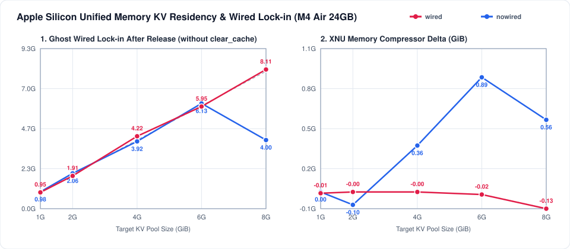

# kvos-lab

> **KVOS（Unified Memory & KV Cache Residency Observatory for Apple Silicon）**  
> 把操作系统虚拟内存与物理页管理（`mincore`、`vm_stat`、16 KiB 页表、Metal IOGPU wired limit）引入 Apple Silicon（MLX / Metal）的 LLM 推理 KV Cache，解决端侧统一内存下 **“框架逻辑分配 ≠ 页表物理常驻 ≠ 内核锁页（wired）”** 的观测与治理盲区。

## 项目定位：KVOS × Lab

本项目采用 **“核心工具链 + 实证实验室”** 双层结构，首页聚焦 **KVOS** 本身，完整实验细节沉淀在 **Lab** 文档中：

| 模块 | 定位 | 包含内容 |
| :--- | :--- | :--- |
| **KVOS（核心工具链）** | 面向 Apple Silicon 统一内存的观测、容量预算与自适应治理包（零编译依赖，纯 Python CLI） | `kvos/`：`status` / `doctor` / `budget` / `sim` / `bench` / `plot` 与双平面（`live` / `context`）策略原语 |
| **Lab（Practical 实验室）** | 针对真实推理引擎（`vllm-metal`、`SGLang`）的真机物理页实验、复现脚本与原始数据 | `sim/`、`experiments/`、`results/`，完整实验报告见 [`docs/EXPERIMENTS.md`](docs/EXPERIMENTS.md) |

## 为什么做 Apple Silicon 差异化？

主流推理框架沿用独立显存（CUDA）的内存假设，只监控分配器的逻辑计数（如 `mx.get_active_memory()`）。但在 16–24 GB Apple Silicon 统一内存上，KV Cache 同时受三层机制支配：

1. **框架逻辑层（MLX Allocator）**：`mx.zeros()` 惰性构建计算图，未 `eval` 前物理页为 0；释放引用后旧 buffer 退入 MLX cache，逻辑 active 归零但并未归还操作系统。
2. **页表常驻层（Darwin `mincore`）**：GPU 首次触碰某个 KV block，会把其所属的**整块 Metal buffer** 提交为 16 KiB 物理常驻页。
3. **内核锁页层（XNU `vm_stat wired`）**：开启 `mx.set_wired_limit` 后，退入 MLX cache 的闲置 buffer 仍被锁在物理内存中不可换出（**Ghost Wired Pages**），极易在消费级 Mac 上诱发内存压缩与卡顿。

## 核心真机发现（MacBook Air M4 24GB）



- **实验 1（vllm-metal 分块与分配顺序）**：仅拆小 KV buffer 在 FIFO 队列下只是推迟整池常驻；配合 **LowestId（优先复用最小块号）** 才能将 4 GiB 池的物理常驻长期压在 `1.31 GiB`（`mincore` 实测误差 `0.00 GiB`）。
- **实验 2（SGLang `MlxAttentionKVPool` 幽灵锁页）**：默认 `wired` 模式下调用 `pool.clear()` 后，`mlx_active` 归零，但内核 `wired` 仍锁死 **`+2.23 GiB`**。
- **实验 3（1–8 GiB 梯度拐点压测）**：`wired` 模式下释放引用不调 `mx.clear_cache()` 时，幽灵锁页从 `0.95 GiB` 线性涨至 `8.11 GiB`；`nowired` 模式在 `8.00 GiB` 触发系统主动回收，回落至 `4.00 GiB`。

> 查看完整数据表、原始输出与复现命令：[`docs/EXPERIMENTS.md`](docs/EXPERIMENTS.md)

## 快速上手（Quick Start）

```bash
# 1. 可编辑安装（核心 CLI 零外部依赖；跑 bench 需要 mlx 环境）
pip install --no-build-isolation --no-deps -e .

# 2. 一键体检当前 Mac 统一内存与压力状态
kvos doctor

# 3. 计算 24GB Mac 跑 4.5 GiB 权重模型时的安全 KV 槽位与缓存上限
kvos budget --weights-gib 4.5

# 4. 对比 FIFO 与 LowestId 分配器触达的缓冲区比例
kvos sim --blocks 512 --requests 80

# 5. 在 MLX 环境中跑 1-8 GiB 梯度压测并自动输出 SVG 图表
kvos bench --steps 1.0,2.0,4.0,6.0,8.0 --out results/bench-m4-air.csv --plot results/bench-m4-air.svg
```

## 仓库结构

```text
kvos-lab/
├── kvos/                  # KVOS 核心包（probe / apple / budget / policy / governor / bench / plot / cli）
├── docs/EXPERIMENTS.md    # Lab 实验 1-3 完整报告与复现命令
├── experiments/           # 针对 SGLang 等引擎的实证脚本
├── sim/                   # vllm-metal 块分配模拟器与真机 mincore 测量脚本
├── results/               # 实测 CSV、TXT 原始记录与 SVG 图表
└── tests/                 # 单元测试（python3 -m unittest discover -s tests -v）
```

## 上游社区联动

- **vllm-metal**：Issue #1198 统一内存常驻复现与分块粒度实测回复、PR #1351 验证测试
- **SGLang（Apple Silicon / MLX 后端）**：PR #50939（`ci_utils` & Apple Metal 文档）、PR #50963（`async_chained_decode_mlx` 补传 `lazy_logprobs`）、PR #50964（GQA `get_head_dim` 修复）
