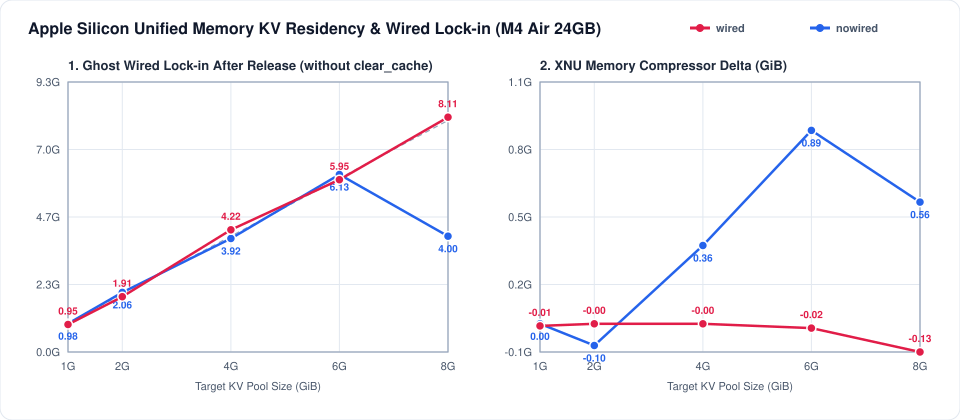

# KVOS Lab — Practical Experiments (Apple Silicon M4 Air 24GB)

本页记录 `kvos-lab` 在 **MacBook Air M4 24GB（无风扇）** 上针对真实推理引擎（`vllm-metal`、`SGLang`、`MLX`）的完整实证过程、模型假设与复现命令。所有原始输出均保存在 [`results/`](../results/)。

---

## 实验 1：拆小 KV 缓冲区，能省多少常驻内存？（vllm-metal）

- **背景**：vllm-metal #1198 与 PR #1351。KV 池在服务就绪前就整体常驻有两个原因：一是 MLX `wired limit` 锁页，二是 GPU 读一个块会把其所在的整块 Metal buffer 提交为物理常驻页。
- **问题**：按 vLLM 现有的 FIFO 块分配顺序，把每层拆成 64 MiB / 16 MiB 小缓冲区，长期能省多少物理内存？

### 模拟结果（8 GiB 池，28 层，`--max-seqs 4`，峰值实际 KV 约 1.02 GiB）

| 完成请求数 | 每层 1 个缓冲区 | 按层拆 64 MiB | 按层拆 16 MiB | 按块范围拆 64 MiB |
| :--- | ---: | ---: | ---: | ---: |
| `fifo`，1 | 8.00 GiB | 1.75 GiB | 0.88 GiB | 0.66 GiB |
| `fifo`，10 | 8.00 GiB | 3.50 GiB | 2.62 GiB | 2.36 GiB |
| `fifo`，20 | 8.00 GiB | 5.25 GiB | 4.52 GiB | 4.39 GiB |
| `fifo`，40 | 8.00 GiB | 8.00 GiB | 8.00 GiB | 7.98 GiB |
| **`lowest`，400** | **8.00 GiB** | **1.75 GiB** | **1.31 GiB** | **1.05 GiB** |

### 真机验证（4 GiB 池，28 层，80 请求，`mincore` 实测误差 0.00 GiB）

脚本：[`sim/chunk_measure.py`](../sim/chunk_measure.py)，原始输出：[`results/`](../results/)。

| 配置 | 1 请求后 | 10 请求后 | 20 请求后 | 80 请求后 |
| :--- | ---: | ---: | ---: | ---: |
| `fifo`，每层 1 个缓冲区 | 4.00 GiB | 4.00 GiB | 4.00 GiB | 4.00 GiB |
| `fifo`，64 MiB | 1.75 GiB | 3.50 GiB | 4.00 GiB | 4.00 GiB |
| `fifo`，16 MiB | 0.88 GiB | 2.62 GiB | 4.00 GiB | 4.00 GiB |
| `lowest`，64 MiB | 1.75 GiB | 1.75 GiB | 1.75 GiB | 1.75 GiB |
| **`lowest`，16 MiB** | **0.88 GiB** | **0.88 GiB** | **1.31 GiB** | **1.31 GiB** |

**结论**：仅拆小缓冲区在 FIFO 分配下只是推迟整池常驻；必须配合**优先复用最小块号（`LowestId`）**才能把物理常驻长期压在真实峰值附近。

---

## 实验 2：SGLang `MlxAttentionKVPool` 的惰性分配陷阱与 Wired 幽灵锁页

- **背景**：SGLang MLX 后端的 `MlxAttentionKVPool`（`attention_kv_pool.py`）用 `mx.zeros(...)` 初始化与 `clear()`，且 `MlxModelRunner` 默认开启 `mx.set_wired_limit(max_recommended_working_set_size)`。
- **脚本**：[`experiments/sglang_kv_pool_residency.py`](../experiments/sglang_kv_pool_residency.py)，原始输出：[`results/exp2-sglang-kv-pool-mac.txt`](../results/exp2-sglang-kv-pool-mac.txt)。

### 真机实测（2.00 GiB KV 池，28 层，56 个 buffer）

| 阶段 | `nowired` `mincore` | `nowired` `mlx_active` | `nowired` OS `wired` | `wired` `mincore` | `wired` `mlx_active` | `wired` OS `wired` |
| :--- | ---: | ---: | ---: | ---: | ---: | ---: |
| 1. `after __init__ (lazy)` | 0.00 GiB | +0.00 GiB | +0.00 GiB | 0.00 GiB | +0.00 GiB | +0.00 GiB |
| 2. `after mx.eval(pool)` | 2.00 GiB | +2.00 GiB | +1.93 GiB | 2.00 GiB | +2.00 GiB | +2.22 GiB |
| 3. `after unrelated op` | 2.00 GiB | +2.00 GiB | -0.10 GiB | 2.00 GiB | +2.00 GiB | +2.23 GiB |
| 4. **`after clear() (lazy)`** | **0.00 GiB** | **+0.00 GiB** | **-0.09 GiB** | **0.00 GiB** | **+0.00 GiB** | **+2.23 GiB** |
| 5. `after clear() + eval` | 2.00 GiB | +2.00 GiB | +1.91 GiB | 2.00 GiB | +2.00 GiB | +2.23 GiB |

**结论**：`wired` 模式下调用 `pool.clear()` 后，`mx.get_active_memory()` 降为 `0.00 GiB`，但旧 buffer 退入 MLX Metal cache 并仍被内核 `wired` 锁死在 **`+2.23 GiB`**（幽灵锁页）。

---

## 实验 3：24GB 统一内存 1–8 GiB 梯度压测（`kvos bench`）

- **脚本**：`kvos bench --steps 1.0,2.0,4.0,6.0,8.0 --out results/bench-m4-air.csv --plot results/bench-m4-air.svg`
- **原始数据**：[`results/bench-m4-air.csv`](../results/bench-m4-air.csv)

**结论**：
1. **`wired` 模式 1:1 线性死锁**：1G → 8G 释放引用但不调 `mx.clear_cache()` 时，`Ghost Lock` 从 `0.95 GiB` 线性涨至 `8.11 GiB`，OS 无法主动回收。
2. **`nowired` 模式在 8G 触发回收拐点**：在 6G 出现 `+0.89 GiB` XNU 压缩后，到 8G 释放时 `Ghost Lock` 回落至 `4.00 GiB`，系统主动回收了一半以上的闲置缓冲页。
3. **24GB 安全区**：8 GiB 以内 `Swap+` 全程为 `0.00 GiB`，预热后 matmul 中位数延迟稳定在 `1.46–3.65 ms`。
